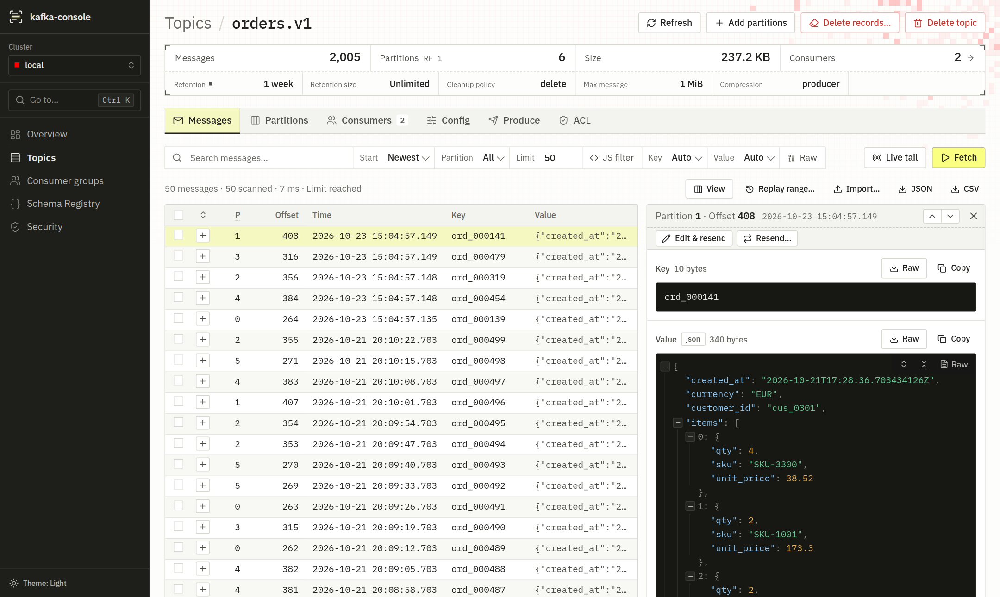
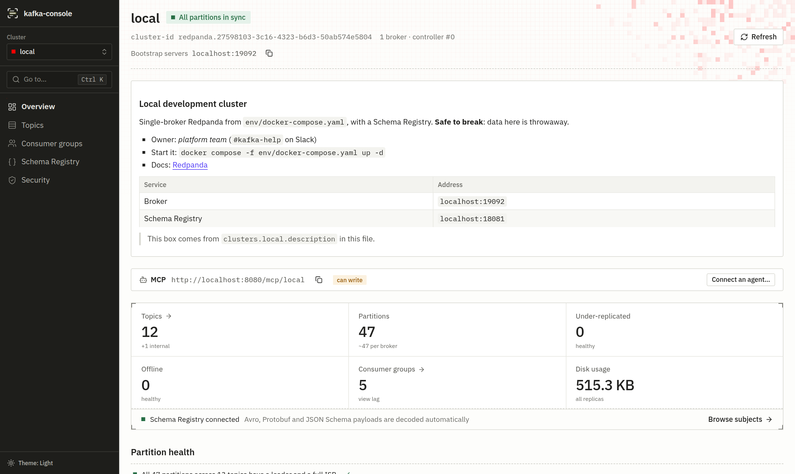
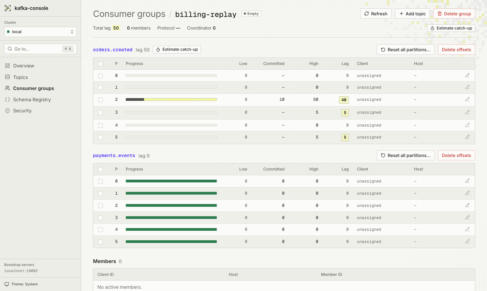
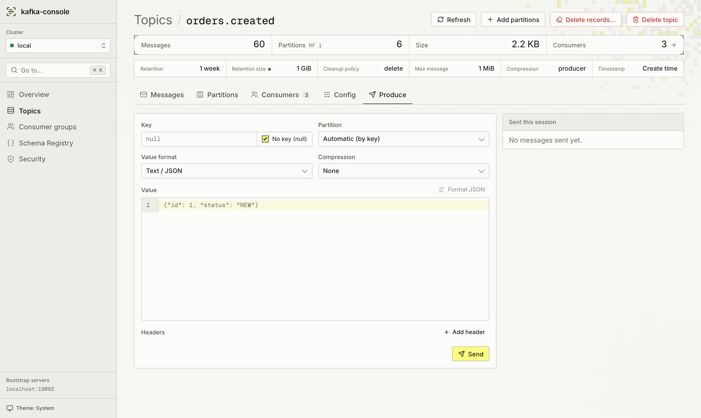
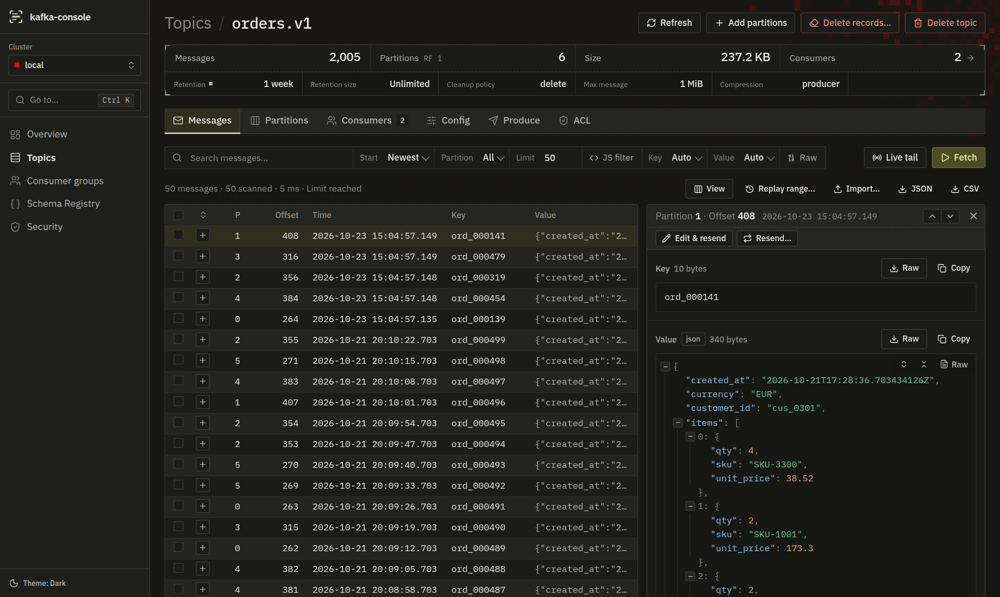

# kafka-console

[](LICENSE)
[](https://github.com/rakunlabs/kafka-console/releases/latest)
[](https://github.com/rakunlabs/kafka-console/actions/workflows/test.yml)

Web console for Apache Kafka. One binary with the UI embedded. Point it at
one or more clusters and see what is in a topic, who is consuming it and how
far behind they are.



<table>
  <tr>
    <td width="50%"><br><sub>Cluster overview</sub></td>
    <td width="50%"><br><sub>Consumer group lag and offset reset</sub></td>
  </tr>
  <tr>
    <td width="50%"><br><sub>Produce</sub></td>
    <td width="50%"><br><sub>Dark theme</sub></td>
  </tr>
</table>

## Features

- **Overview:** brokers, controller, partition health, disk usage.
- **Topics:**
  - Partitions, replicas, ISR, offsets and size.
  - Create and delete topics, edit config, add partitions, delete records.
- **Messages:**
  - Browse by offset, timestamp, newest or oldest.
  - Text search, JavaScript filters, live tail, JSON tree view.
  - Resend messages to another topic.
  - Open a message in Produce to edit its key, value or headers, review changes, and send a new record to the same or another topic.
  - Replay a range by offset or time, with the same search and JS filter, to another topic or back into the same one. Shows a count before writing and progress while it runs.
  - Import records from a file: a JSON or CSV export from this console, JSON lines, or one value per line. Can keep partitions, timestamps and schema IDs. The file is read as a stream, so any size works. Every record is checked before any is written, and a stopped or failed import can resume from the first unwritten record.
- **Produce:** key, headers, partition, compression, base64, or JSON encoded with a registry schema.
- **Consumer groups:**
  - Per-partition lag and catch-up estimate.
  - Reset offsets with a preview: earliest, latest, offset, timestamp or shift.
  - Create a group or add a topic to one.
- **Schema Registry:**
  - Avro, Protobuf and JSON Schema decoding.
  - Subjects, versions, compatibility, create and delete.
- **Security:** ACLs, SCRAM users, client quotas.
- **Operator safety:**
  - Per-cluster `read_only` and `production` flags.
  - Switch off features such as topic create or delete; see [Features](#features-1).
  - An audit log line for every write.
  - Confirmation before destructive actions.
- **MCP (optional):** expose the shared [kafka-mcp](https://github.com/denizgursoy/kafka-mcp) tools on the same HTTP server, read-only by default.
- **Large clusters:** works with thousands of topics and groups. Lists page, pickers load names only, and Overview reports only unhealthy topics.

## Quick start

Write a minimal `kafka-console.yaml`:

```yaml
clusters:
  local:
    brokers: ["host.docker.internal:9092"]
```

Run it:

```sh
docker run -d --name kafka-console -p 8080:8080 \
  -v "$PWD/kafka-console.yaml:/etc/kafka-console.yaml:ro" \
  ghcr.io/rakunlabs/kafka-console:latest
```

Open http://localhost:8080.

Binaries for Linux, macOS and Windows are on the
[releases page](https://github.com/rakunlabs/kafka-console/releases). Run the
binary in the same folder as `kafka-console.yaml`.

## Configuration

`kafka-console.yaml` (or `.yml`, `.json`, `.toml`) is loaded from the working
directory or `/etc`. Set `CONFIG_FILE` to use another path.

Environment variables with the `KAFKA_CONSOLE_` prefix override single values
from the file, for example `KAFKA_CONSOLE_SERVER_PORT=9000` or
`KAFKA_CONSOLE_INFO=PreProd`. Define clusters in the file: environment
variables cannot set values inside `clusters`. Read secrets from files with
`password_file`, e.g. a mounted Kubernetes secret.

```yaml
log_level: info
info: PreProd            # label shown beside the app name; omit to hide

server:
  port: "8080"
  # base_path: /kafka    # serve under a sub-path behind a reverse proxy
  # user_header: X-User  # header your auth proxy sets; logged on every write

# features:              # every feature is on unless set to false; see Features below
#   create_topic: false
#   delete_topic: false

clusters:
  local:
    brokers: ["localhost:9092"]
    schema_registry:
      urls: ["http://localhost:8081"]

  prod:
    brokers: ["kafka-1.prod:9093", "kafka-2.prod:9093"]
    production: true     # red banner and warnings in the UI
    read_only: true      # refuses produce, topic changes, offset resets
    tls:
      enabled: true
      ca_file: /etc/kafka/ca.pem
      # cert_file / key_file for mTLS, insecure_skip_verify
    sasl:
      mechanism: scram-sha-512   # plain | scram-sha-256 | scram-sha-512 | oauthbearer
      user: console
      password_file: /run/secrets/kafka-password
    schema_registry:
      urls: ["https://registry.prod:8081"]
      user: console              # basic auth, or token: <bearer>
      password_file: /run/secrets/registry-password
```

### Features

Switch off parts of the console you do not want offered, for example when
its credentials lack the ACL for them. Every feature is on unless set to
`false`; leaving a key out keeps it on.

```yaml
features:
  create_topic: false
  delete_topic: false
```

A feature that is off is removed everywhere: its buttons and pages are gone
from the UI, its API routes answer 404, and its MCP tools are not offered
(an MCP endpoint's `tools` cannot switch them back on).

| Key | Turns off | MCP tools |
|---|---|---|
| `security` | The Security section: ACLs, SCRAM users, client quotas | `list_acls` |
| `create_topic` | Create topic | `create_topic` |
| `delete_topic` | Delete topic | `delete_topic` |
| `alter_topic` | Editing topic config and adding partitions | `alter_topic_config`, `add_partitions` |
| `delete_records` | Delete records from a topic | `delete_records` |
| `delete_group` | Delete consumer group | `delete_consumer_group` |

Features apply to every cluster. To block all writes on one cluster, use its
`read_only` flag instead. Environment variables work too, for example
`KAFKA_CONSOLE_FEATURES_DELETE_TOPIC=false`.

### OAUTHBEARER

With `mechanism: oauthbearer`, configure exactly one way to get a token under
`sasl.oauth`. The keys match
[wkafka](https://github.com/worldline-go/wkafka), so the same block connects
the same way in both.

**Static token.** It is never renewed.

```yaml
oauth:
  token: eyJ...
```

**Client credentials.** Tokens are cached and renewed before they expire.

```yaml
oauth:
  token_url: https://idp.example.com/oauth2/token
  client_id: kafka-console
  client_secret: ""          # optional with a client certificate (RFC 8705)
  scopes: [kafka]
  # tls:                     # mutual TLS to the token endpoint
  #   cert_file: /etc/certs/client.pem
  #   key_file: /etc/certs/client-key.pem
  #   ca_file: /etc/certs/ca.pem
  # proxy: http://proxy:3128 # http, https, socks5, socks5h; default HTTPS_PROXY
  # timeout: 10s
  # zid: ""                  # authorization identity
  # extensions: {}           # SASL extensions
```

**Google Cloud.** This uses X.509 workload identity federation, optionally
impersonating a service account. Use `format: managed_kafka` for Google
Managed Service for Apache Kafka.

```yaml
tls:
  enabled: true
sasl:
  mechanism: oauthbearer
  oauth:
    gcp:
      enabled: true
      credentials_file: /etc/certs/gcp/wif-credentials.json  # external_account JSON
      cert_file: /etc/certs/gcp/client.pem
      key_file: /etc/certs/gcp/client-key.pem
      format: managed_kafka
      # audience, token_url and service_account_impersonation_url
      # override the values in credentials
      # scopes: [https://www.googleapis.com/auth/cloud-platform]
      # lifetime: 1h             # impersonated token lifetime
      # refresh_before: 5m
      # proxy: ""                # falls back to oauth.proxy
```

Certificates, keys and CAs can be given inline (`cert`, `key`, `ca`,
`credentials`) or as files (`*_file`), but not both for the same value. Files
are re-read on each token refresh, so rotated certificates work without a
restart. If a refresh fails while the current token is still valid, the
current token keeps being used.

### Authentication and audit

kafka-console has no login of its own. Put it behind your authenticating
proxy (OAuth2 Proxy, an ingress with SSO, …) and have the proxy set a user
header. Every write request is logged with that user, the cluster, the action
and its target. Request bodies are not stored, and secrets are redacted.

```json
{"level":"INFO","msg":"audit","user":"ada@example.com","cluster":"prod","action":"groups.reset","method":"POST","status":200,"target_group":"billing"}
```

## MCP endpoint

MCP is off by default. Enable it in the same console configuration:

```yaml
mcp:
  enabled: true
  auth_token: "replace-with-a-secret" # or KAFKA_CONSOLE_MCP_AUTH_TOKEN
  # allow_writes: false             # default; separate from the UI's permissions
  # output_dir: /var/lib/kafka-console/exports
```

Each configured cluster gets a Streamable HTTP endpoint at `/mcp/<cluster>`
on the console's existing port. `server.base_path` prefixes these paths too:
`base_path: /kafka` makes the local URL `/kafka/mcp/local`. Unknown MCP paths
return 404, not the UI. Connect an MCP client, for example:

```json
{
  "mcp": {
    "kafka-local": {
      "type": "remote",
      "url": "http://localhost:8080/mcp/local",
      "headers": {"Authorization": "Bearer {env:KAFKA_CONSOLE_MCP_AUTH_TOKEN}"}
    }
  }
}
```

For separate endpoint policies, configure an explicit map. Every console
cluster is visible to `list_clusters` and `compare_clusters`:

```yaml
mcp:
  enabled: true
  allow_writes: true
  endpoints:
    prod-read:
      cluster: prod
      path: /mcp/prod
      read_only: true
      destinations: [stage] # explicit cross-cluster write grant; default none
    stage:
      cluster: stage
      path: /mcp/stage
      tools:
        delete_topic: false
```

An endpoint `path` can be anything, for example `/abc/mcp/xyz` or `agents`. It
is relative to `server.base_path` and cleaned, so `/team//kafka/` becomes
`/team/kafka`. Only the paths the console itself needs are refused: `/`, the
`/api` tree, `/healthz`, and router patterns containing `{`, `}` or `*`. Only
the exact configured path is served; anything next to it still goes to the UI.
Everything under `/mcp/` that is not an endpoint returns 404. With `allow_writes: false`, **no MCP
endpoint may write to any cluster**, including named destinations. With it
enabled, a cluster's `read_only: true` still cannot be widened by an endpoint.
MCP writes use kafka-mcp's `confirm` previews, not the UI's typed confirmation;
`production` is a UI warning, not an MCP permission. Call `server_config` to
verify the endpoint, cluster and effective tool policy before acting.

Tool definitions, batch results, mutation guards and audit logging come directly
from `kafka-mcp/pkg/kafkamcp`, the only kafka-mcp package the console imports;
they are not reimplemented here. The console builds one MCP server per
endpoint and serves it on its own router, with its own bearer-token and origin
checks. MCP borrows the
console's existing Kafka, admin and Schema Registry clients, and its cached
manual-partition producer. No broker/TLS/SASL/OAuth configuration is converted
or reloaded. Message scans use the console's reader factory to create isolated
short-lived consumers, since consuming state cannot safely be shared between
concurrent calls. MCP never closes the console's clients.
`server_config` reports authentication as `host-managed`, with the console's
configured brokers and SASL user; credentials are never passed on.
Its tool audit records identify the endpoint, configured principal when supplied, and MCP client;
the console's `server.user_header` does not add a person to these records.

The bearer token is optional only when a trusted authenticating proxy or network
boundary already protects MCP. Proxy protection must cover `/mcp` as well as
`/api`. Browser origins are rejected by default; allow a trusted browser MCP
client with `mcp.allow_origins: ["https://trusted-client.example"]`. An allowed
origin may drive all tools exposed to it. The UI's existing auth behavior is unchanged.

## Development

### Build and run

Requires Go and pnpm 11 or newer. The UI's `package.json` pins pnpm and Node.js, and pnpm downloads that Node.js version itself.

```sh
make env              # local Redpanda broker with Schema Registry
make run              # backend on :8080 with kafka-console.local.yaml
make run-ui           # UI dev server with hot reload (proxies /api to :8080)
make test             # Go tests
make lint             # golangci-lint and UI type-check
make build            # snapshot binary with goreleaser, linux/amd64 by default
make build-container  # kafka-console:test image from that binary
make snapshot         # every archive and both images, nothing published
```

Build for another platform with `make build GOOS=darwin GOARCH=arm64`.

Pushing a `v*` tag runs GoReleaser in CI. It publishes the archives and a
multi-arch image (linux/amd64 and linux/arm64) to `ghcr.io`.
